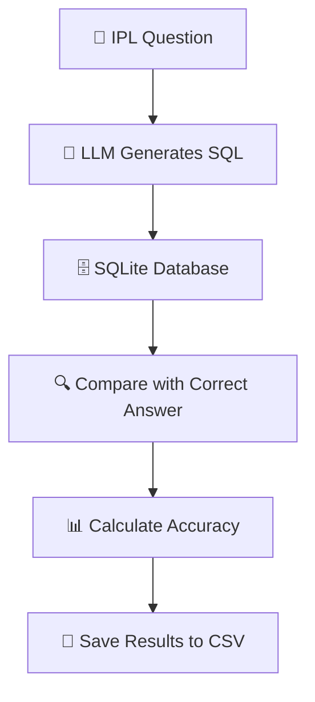

# 🏏 Competing Models — LLM Text-to-SQL Evaluation

<p align="center">
  <b>Which LLM converts natural language into SQL most accurately?</b>
  <br/>
  Benchmarking five AI models using IPL data from 2021–2024.
</p>

<p align="center">
  
  
  
  
</p>

## 🎯 About

**Competing Models** evaluates five Large Language Models (LLMs) on their ability to translate English questions into SQL queries, execute them against an IPL database, and return correct results.

## ⚙️ How It Works



## 📊 Benchmark Results

| Model | Correct Answers | Accuracy |
|---|---:|---:|
| GPT-5.6 Terra | 4/20 | 20% |
| MiniMax M3 | 3/20 | 15% |
| Kimi K3 | 0/20 | 0% |
| Grok 4.5 | 0/20 | 0% |
| Claude Sonnet 5 | 0/20 | 0% |

> [!IMPORTANT]
> These are preliminary results from the current run, not a definitive ranking of model capabilities. Many requests failed during SQL generation, so the evaluation should be rerun after resolving those errors.

## 🧰 Tech Stack

- **Python** — evaluation logic
- **OpenRouter** — access to LLMs
- **LangChain** — model integration
- **SQLite** — IPL database
- **Pandas** — data processing and result reporting

## 🚀 Getting Started

**1. Clone the repository**
```bash
git clone <YOUR_REPOSITORY_URL>
cd <YOUR_REPOSITORY_FOLDER>
```

**2. Install dependencies**
```bash
pip install -r requirements.txt
```

**3. Configure your API key** in a `.env` file:
```env
OPENROUTER_API_KEY=your_api_key_here
```

**4. Run the evaluation**
```bash
python main.py
```

## 📁 Project Files

<details>
<summary><b>View important files</b></summary>

| File | Purpose |
|---|---|
| `main.py` | Runs the complete evaluation |
| `evaluator.py` | Compares generated and correct results |
| `model_openrouter_slug.py` | Configures the five models |
| `golden_dataset.csv` | Benchmark questions and expected answers |
| `schema.sql` | Database structure for SQL generation |
| `ipl_2021_2024.db` | IPL database |
| `eval_results.csv` | Detailed evaluation results |

</details>

## 🔮 Future Improvements

- Resolve generation errors and rerun the benchmark.
- Add more models and complex SQL questions.
- Compare latency, API cost, and execution accuracy.
- Build a dashboard for interactive model comparisons.

## 👨‍💻 Author

**Tanmay Shukla**

---

⭐ *Exploring how reliably competing LLMs turn natural language into executable SQL.*
